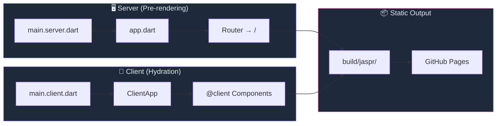
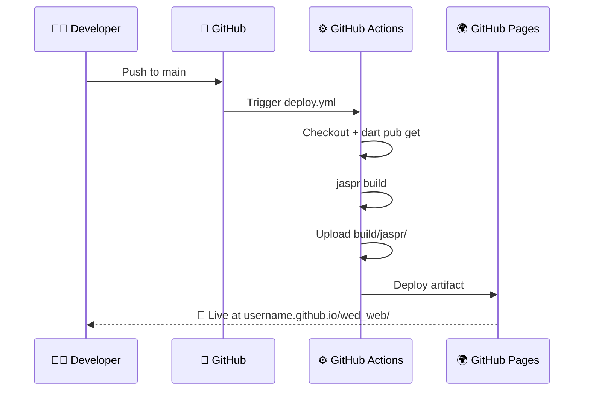

<!-- Animated Header Banner -->
<p align="center">
  
</p>

<p align="center">
  
</p>

<p align="center">
  
  
  
  
</p>

---

<br />

##  &nbsp; Overview

> [!TIP]
> **This document is an AI context file.** It gives AI coding assistants (and human developers)
> a complete mental model of the project — architecture, file responsibilities, design tokens,
> conventions, and known quirks — so they can contribute effectively without exploring the codebase first.

**`wed_web`** is a **single-page wedding invitation** for *Rose Mae & Daryl*, built with
[Jaspr](https://jaspr.site) — the Dart web framework — and served as a static site.
The design follows the [Ceremo *Romantic*](https://www.useceremo.com/demo/romantic) template:
an "envelope" cover, a live countdown, gift details with copy-to-clipboard, a dress-code
palette, an FAQ accordion and a per-guest RSVP.

The invitation is a vertical scrolling experience with **17 distinct sections**, opened by a
full-screen "envelope" cover:

```mermaid
flowchart TD
    C0["💌 Cover — Envelope, monogram, Tap to open"] --> A["🏔️ Hero — Names, date, venue, live countdown"]
    A --> B["💬 Intro — Celebratory one-liner"]
    B --> S["📖 Our Story — Portrait + 3 milestones"]
    S --> P["🎬 Our prenup film — Poster + play button"]
    P --> G["🎁 A note on gifts — GCash / Bank + Copy"]
    G --> D["📍 Where — Ceremony & Reception + Directions"]
    D --> T["🕐 The Day — Order-of-events timeline"]
    T --> E["👑 The Entourage — Wedding party"]
    E --> AT["🤵 The Printed Invitation — Dress code + palette"]
    AT --> F["❓ Good to know — FAQ accordion"]
    F --> R["🔔 A few reminders"]
    R --> RS["✉️ RSVP — Per-guest response + counter"]
    RS --> SE["🪑 On the day — Find your seat / Share photos"]
    SE --> PH["📸 Photos — Guest photo wall"]
    PH --> FO["🦶 Footer — With love, Rose & Daryl"]

    style C0 fill:#8a6b40,stroke:#c9ae7e,color:#fff
    style A fill:#2c2724,stroke:#c9ae7e,color:#fff
    style B fill:#fbf8f3,stroke:#ded5c7,color:#332e2a
    style S fill:#f4ede3,stroke:#ded5c7,color:#332e2a
    style P fill:#2c2724,stroke:#c9ae7e,color:#fff
    style G fill:#fbf8f3,stroke:#ded5c7,color:#332e2a
    style D fill:#f4ede3,stroke:#ded5c7,color:#332e2a
    style T fill:#fbf8f3,stroke:#ded5c7,color:#332e2a
    style E fill:#f4ede3,stroke:#ded5c7,color:#332e2a
    style AT fill:#f6e3e1,stroke:#c08a86,color:#332e2a
    style F fill:#fbf8f3,stroke:#ded5c7,color:#332e2a
    style R fill:#2c2724,stroke:#c9ae7e,color:#fff
    style RS fill:#f4ede3,stroke:#ded5c7,color:#332e2a
    style SE fill:#ede4d8,stroke:#ded5c7,color:#332e2a
    style PH fill:#fbf8f3,stroke:#ded5c7,color:#332e2a
    style FO fill:#2c2724,stroke:#c9ae7e,color:#fff
```

<p align="center">



</p>

<br />

---

##  &nbsp; Architecture

<p align="center">



</p>

### How Jaspr works here

| Phase | What happens | File |
|:------|:-------------|:-----|
| **Pre-render** | Server renders the HTML for SEO & fast first paint | `lib/main.server.dart` |
| **Hydration** | Client JS takes over `@client` components for interactivity | `lib/main.client.dart` |
| **Build** | `jaspr build` produces a fully static `build/jaspr/` directory | — |

> [!IMPORTANT]
> The `<base>` href is set to `/wed_web/` in `main.server.dart` because the site deploys to
> `https://<username>.github.io/wed_web/`. Change to `/` if deploying from the root repo.

<br />

---

##  &nbsp; Tech Stack

<p align="center">

| Technology | Version | Role |
|:-----------|:--------|:-----|
| **Dart** | `^3.10.0` | Language |
| **Jaspr** | `^0.23.3` | Web framework (Flutter-like API for the web) |
| **jaspr_router** | `^0.9.0` | Client-side routing |
| **jaspr_builder** | `^0.23.3` | Code generation for `@css` and `@client` |
| **build_runner** | `^2.10.0` | Build system orchestrator |
| **build_web_compilers** | `^4.8.0` | Dart-to-JS compilation |
| **jaspr_lints** | `^0.7.2` | Jaspr-specific lint rules |
| **GitHub Actions** | — | CI/CD → GitHub Pages |

</p>

<br />

---

##  &nbsp; File Map

> [!NOTE]
> **Everything editable lives in just 2 files.** Change `wedding_data.dart` for content and `theme.dart` for styling.

```
wed_web/
├── lib/
│   ├── app.dart                          ← App root + Router config
│   ├── main.server.dart                  ← Server entrypoint (pre-rendering)
│   ├── main.client.dart                  ← Client entrypoint (hydration)
│   │
│   ├── constants/
│   │   ├── 📝 wedding_data.dart          ← ALL editable text/content ⭐
│   │   └── 🎨 theme.dart                 ← ALL colors, fonts, shadows ⭐
│   │
│   ├── pages/
│   │   └── invitation.dart               ← Section assembly + shared CSS + inline JS
│   │
│   └── components/
│       ├── header.dart                   ← (Legacy nav, not used in invitation)
│       └── invitation/
│           ├── section_heading.dart      ← Shared "kicker + title" block
│           ├── cover_screen.dart         ← Full-screen envelope cover
│           ├── nav_bar.dart              ← Fixed top bar with anchor links
│           ├── hero_section.dart         ← Hero + live countdown
│           ├── intro_section.dart        ← Editorial intro paragraph
│           ├── story_section.dart        ← Portrait + 3 milestones
│           ├── prenup_section.dart       ← Prenup film poster + play button
│           ├── gifts_section.dart        ← Gift tabs + copy-to-clipboard
│           ├── details_section.dart      ← Ceremony & Reception + Directions
│           ├── schedule_section.dart     ← Order-of-events timeline
│           ├── entourage_section.dart    ← Wedding-party groups
│           ├── attire_section.dart       ← Dress code, palette, attire guide
│           ├── faq_section.dart          ← "Good to know" accordion
│           ├── reminders_section.dart    ← Day-of reminders
│           ├── rsvp_section.dart         ← Per-guest response form
│           ├── seat_section.dart         ← Find your seat / Share photos
│           ├── gallery_section.dart      ← Photo wall grid
│           └── footer_section.dart       ← Sign-off + links
│
├── web/images/                           ← Static image assets
├── .github/workflows/deploy.yml          ← GitHub Pages CI/CD
├── pubspec.yaml                          ← Dart dependencies
├── analysis_options.yaml                 ← Linter & formatter config
├── README.md                             ← Project README
└── ai_context.md                         ← 🤖 This file!
```

### Quick Reference: "I want to change…"

| What you want to change | Edit this file |
|:------------------------|:---------------|
| Couple's names, date, venue | `lib/constants/wedding_data.dart` |
| Story paragraphs | `lib/constants/wedding_data.dart` |
| Schedule items | `lib/constants/wedding_data.dart` |
| Gallery photos (URLs) | `lib/constants/wedding_data.dart` |
| RSVP deadline | `lib/constants/wedding_data.dart` |
| Colors & fonts | `lib/constants/theme.dart` |
| Hero section layout | `lib/components/invitation/hero_section.dart` |
| Any other section layout | `lib/components/invitation/<section>_section.dart` |
| Routing | `lib/app.dart` |
| Deployment base path | `lib/main.server.dart` |

<br />

---

##  &nbsp; Design System — "Romantic"

<p align="center">
  
  
  
</p>

> A warm, editorial palette — **paper · champagne · antique gold · sage · charcoal** —
> modelled on the Ceremo *Romantic* invitation template.

### 🎨 Color Palette

| Token | Hex | Role |
|:------|:----|:-----|
| `surface` | `#fbf8f3` | Page background (paper) |
| `surfaceContainer` | `#f4ede3` | Tonal band (Story, Where, RSVP) |
| `surfaceContainerLow` | `#f7f2ea` | Subtle layer |
| `surfaceContainerHigh` | `#ede4d8` | "On the day" band |
| `onSurface` | `#332e2a` | Charcoal ink |
| `onSurfaceVariant` | `#6e665c` | Secondary text |
| `outlineVariant` | `#ded5c7` | Hairlines & borders |
| `inverseSurface` | `#2c2724` | Dark bands (film, reminders, footer) |
| `inverseOnSurface` | `#f6efe6` | Text on dark bands |
| `primaryColor` | `#8a6b40` | Antique gold — kickers, buttons, links |
| `primaryContainer` | `#e8d9be` | Champagne |
| `primaryFixedDim` | `#c9ae7e` | Light gold on dark bands |
| `secondaryColor` | `#7c8a72` | Sage — schedule venues, "complete" state |
| `secondaryContainer` | `#e4e8dc` | Sage tint |
| `accentColor` | `#c08a86` | Soft rose |
| `accentContainer` | `#f6e3e1` | Soft rose tint (Attire band, active RSVP chip) |
| `errorColor` | `#a93b3b` | "Regretfully declines" state |

### 🔤 Typography

| Role | Font Family | Weight | Usage |
|:-----|:------------|:-------|:------|
| **Headlines** | Cormorant Garamond | 300–700 | Hero names, section titles, card titles |
| **Body / Labels** | Jost | 300–600 | Paragraphs, nav, buttons, kickers, labels |
| **Script** | Great Vibes | 400 | Footer sign-off ("With love,") |

### 🌫️ Elevation

| Name | Shadow | Usage |
|:-----|:-------|:------|
| `ambientShadow` | `0px 18px 50px rgba(51,46,42,0.08)` | Cover card, gift card, RSVP card, detail cards |
| `softShadow` | `0px 6px 20px rgba(51,46,42,0.06)` | Cover seal, active gift tab, palette swatches |

<br />

---

##  &nbsp; Getting Started

### 🚀 Run locally

```bash
jaspr serve
```
> Development server at `http://localhost:8080` with hot reload.

### 📦 Build for production

```bash
jaspr build
```
> Static output → `build/jaspr/`

### 🌍 Deploy

Pushing to `main` triggers `.github/workflows/deploy.yml` which builds and deploys to **GitHub Pages**.

<br />

---

##  &nbsp; Developer Notes — Jaspr Quirks

> [!WARNING]
> These are **non-obvious Jaspr API behaviors** that have bitten us before. Read these before editing styles or components!

| # | Quirk | What to do |
|:--|:------|:-----------|
| 1 | **`Gap` is not const-safe** — `Gap.all(...)`, `Gap.column(...)` built from extension getters (`1.rem`, `.zero`) are *not* const-constructible | ❌ Don't prefix with `const` |
| 2 | **Enum/getter naming differs from Flutter** — e.g. `.uppercase` → `.upperCase`, `AlignItems.flexStart` → `.start` | ✅ Use Jaspr-specific names |
| 3 | **No `BackgroundImage.image(...)`** — use `ImageStyle.url(...)` for CSS `background-image` | ✅ Use `ImageStyle.url(url)` |
| 4 | **Negative units** — unary minus on a `Unit` is unsupported | ✅ Use `Unit.pixels(-7)` / `Unit.rem(-0.3)` |
| 5 | **No typed `object-fit` / `resize`** — not in Jaspr's typed styles API | ✅ Pass via `raw: {'object-fit': 'cover'}` |
| 6 | **Global `<section>` styling leaks** — `app.dart` forces flex/center on every `<section>` inside `.main` | ✅ Use `<div>` for invitation sub-sections |
| 7 | **Form `placeholder`** — not a constructor parameter on `<input>` | ✅ Set via `attributes` map: `{'placeholder': '...'}` |
| 8 | **Number literals need a dot before the unit** — `7rem` and `1.5rem` are *syntax errors* (`rem` parses as a separate identifier) | ✅ Always write `7.rem`, `1.5.rem`, `0.85.rem` |
| 9 | **`<a target>` takes the `Target` enum, not a string** | ✅ `target: Target.blank` |
| 10 | **No `borderColor` in `styles(...)`** — the border is set as a whole | ✅ `border: Border.all(color: c, width: 1.px)` |
| 11 | **`animation-iteration-count: infinite` can't be expressed** — `Animation(count:)` renders the raw number | ✅ Use a large count (e.g. `count: 100`) |
| 12 | **Scroll reveals are fail-safe by design** — `[data-scroll]` is *visible* by default and only **animates** once `.in-view` is added | ✅ Never hide content in the base CSS rule; use `@keyframes` + `.in-view` |
| 13 | **All styles are global** — component `@css` rules are not scoped | ✅ Prefix every class with its section name (`story-`, `gifts-`, `rsvp-`…) |

<br />

---

##  &nbsp; Component Architecture

```
┌──────────────────────────────────────────────────────────────────┐
│                           app.dart                                │
│                   Router → path: '/' → Invitation                 │
├──────────────────────────────────────────────────────────────────┤
│                                                                   │
│  ┌─ Invitation (@client) ─────────────────────────────────────┐   │
│  │                                                             │   │
│  │  CoverScreen ── full-screen envelope, "Tap to open"          │   │
│  │                                                             │   │
│  │  NavBar ── fixed top bar, anchor links + scroll-spy          │   │
│  │                                                             │   │
│  │  HeroSection ── names, date, venue, live countdown           │   │
│  │  IntroSection                                                │   │
│  │  StorySection        (portrait + 3 milestones)               │   │
│  │  PrenupSection       (poster + play button)                  │   │
│  │  GiftsSection        (tabs + copy-to-clipboard)              │   │
│  │  DetailsSection      (ceremony / reception + directions)     │   │
│  │  ScheduleSection     (order-of-events timeline)              │   │
│  │  EntourageSection    (wedding party)                         │   │
│  │  AttireSection       (dress code + palette)                  │   │
│  │  FaqSection          (accordion)                             │   │
│  │  RemindersSection                                            │   │
│  │  RsvpSection         (per-guest choices + counter)           │   │
│  │  SeatSection                                                 │   │
│  │  GallerySection      (photo wall)                            │   │
│  │  FooterSection                                               │   │
│  │                                                             │   │
│  │  + 2 inline <script> tags:                                   │   │
│  │      scroll-observer     → adds .in-view (scroll reveals)    │   │
│  │      invite-interactions → cover, countdown, FAQ, gift tabs, │   │
│  │                            copy-to-clipboard, RSVP choices,  │   │
│  │                            nav scroll-spy                    │   │
│  └─────────────────────────────────────────────────────────────┘   │
│                                                                   │
│  Data sources:                                                     │
│    ├── wedding_data.dart → all text, names, dates, URLs, guests    │
│    └── theme.dart        → colors, fonts, shadows                  │
│                                                                   │
│  Every section renders a <div id="…"> anchor used by the nav bar.  │
└──────────────────────────────────────────────────────────────────┘
```

<br />

---

##  &nbsp; Conventions

### CSS-in-Dart with `@css`

Every component declares its styles using the `@css` annotation. Jaspr's code-gen compiles these to real CSS at build time.

```dart
@css
static List<StyleRule> get styles => [
  css('.my-class', [
    css('&').styles(
      display: .flex,
      fontFamily: headingFont,    // from theme.dart
      color: primaryColor,        // from theme.dart
    ),
    css('&:hover').styles(opacity: 0.85),
  ]),
  // Responsive
  css.media(MediaQuery.screen(maxWidth: 700.px), [
    css('.my-class').styles(fontSize: 2.rem),
  ]),
];
```

### Responsive Breakpoints

| Breakpoint | What changes |
|:-----------|:-------------|
| `≤ 900px` | Hero names shrink |
| `≤ 860px` | Reminders grid 3 → 2 columns |
| `≤ 760px` | Story stacks (portrait above milestones); entourage grid 3 → 2 columns |
| `≤ 700px` | Nav links compact; photo wall 3 → 2 columns; hero names shrink again |
| `≤ 600px` | Section padding reduced; prenup player 4:3; cover card tightened |
| `≤ 480px` | Entourage grid → 1 column |
| `≤ 420px` | Countdown cells tighten |

### Shared CSS Classes

| Class / attribute | Defined in | Purpose |
|:------------------|:-----------|:--------|
| `.section-head` | `invitation.dart` | Centered wrapper for a kicker + title |
| `.section-kicker` | `invitation.dart` | Small uppercase gold label above section titles |
| `.section-title` | `invitation.dart` | Large serif section heading |
| `.section-kicker.light` / `.section-title.light` | `invitation.dart` | Light variants for dark bands |
| `[data-scroll]` | `invitation.dart` | Fail-safe scroll reveal — visible by default, animates on `.in-view` |
| `[data-scroll="left" / "right" / "scale"]` | `invitation.dart` | Reveal direction / scale variants |
| `[data-scroll-delay="1"…"6"]` | `invitation.dart` | 100 ms stagger steps (`animation-delay`) |
| `.in-view` | added by the observer script | Starts the reveal keyframe animation |
| `html.cover-open` | added by the interactions script | Fades the cover screen away |
| `.no-scroll` (on `body`) | added by the interactions script | Locks page scroll while the cover is open |

<br />

---

##  &nbsp; Deployment Pipeline

<p align="center">



</p>

<br />

---

##  &nbsp; AI Assistant Guidelines

> [!IMPORTANT]
> If you are an AI coding assistant working on this project, please follow these rules:

### ✅ DO

- **Always check `wedding_data.dart` and `theme.dart` first** — 90% of content/style changes happen here
- **Use existing color tokens** from `theme.dart` — don't introduce new hardcoded colors
- **Write number literals with a dot before the unit** — `7.rem`, `1.5.rem`, `0.85.rem` (never `7rem`)
- **Prefix every CSS class with its section name** — all `@css` rules are global, so `story-`, `gifts-`, `rsvp-`… avoid collisions
- **Follow Jaspr's typed CSS API** — use `css('.class').styles(...)`; reach for `raw: {...}` only when a property isn't typed
- **Use `<div>` for invitation sections** — global `<section>` styles in `app.dart` will break layouts
- **Register new sections twice** — add the component to the `Invitation` build list *and* a matching `(href, label)` entry to `NavBar.links`
- **Keep scroll reveals fail-safe** — the base `[data-scroll]` rule must leave content visible; only `.in-view` animates
- **Run `dart analyze lib` before committing** — a single bad unit literal cascades into hundreds of confusing errors
- **Test at mobile widths** (`≤ 700px`) — every section has responsive overrides
- **Preserve the `@client` annotation** on `Invitation` — removing it breaks client hydration

### ❌ DON'T

- **Don't run `build_runner` separately** — `jaspr build` invokes it automatically
- **Don't prefix `Gap` constructors with `const`** — they aren't const-safe
- **Don't use `BackgroundImage.image()`** — use `ImageStyle.url()` instead
- **Don't use unary minus on `Unit`** — use `Unit.pixels(-N)` instead of `-N.px`
- **Don't pass a `String` to `target:`** — use the `Target` enum (`Target.blank`)
- **Don't reach for `borderColor:`** — set the whole border with `Border.all(...)`
- **Don't set `placeholder` as a constructor param** on form inputs — use the `attributes` map

<br />

---

<p align="center">
  
</p>

<p align="center">
  <i>Made with 🌹 for Rose & Daryl's Wedding</i>
</p>

<p align="center">
  <a href="https://github.com/tekashifuta/wed_web">
    
  </a>
</p>

