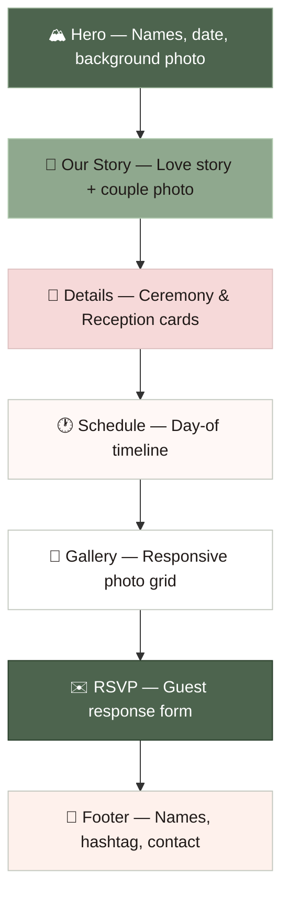
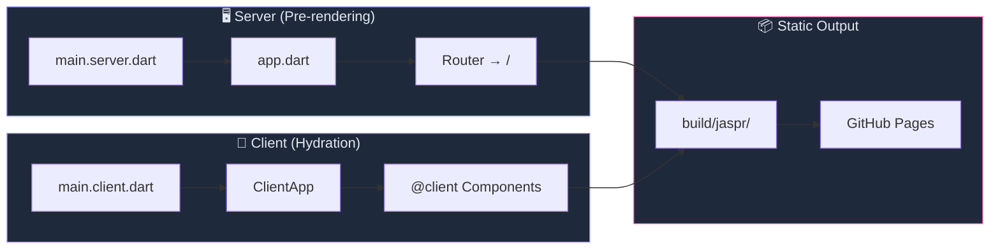
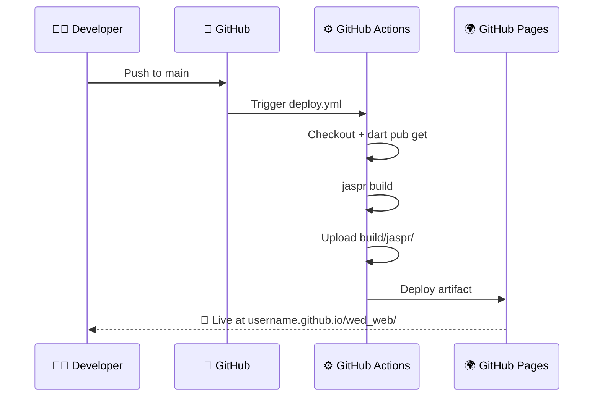

<!-- Animated Header Banner -->
<p align="center">
  
</p>

<p align="center">
  
</p>

<p align="center">
  
  
  
  
</p>

---

<br />

##  &nbsp; Overview

> [!TIP]
> **This document is an AI context file.** It gives AI coding assistants (and human developers)
> a complete mental model of the project — architecture, file responsibilities, design tokens,
> conventions, and known quirks — so they can contribute effectively without exploring the codebase first.

**`wed_web`** is a **single-page garden-wedding invitation** for *Rose Mae & Daryl*, built with
[Jaspr](https://jaspr.site) — the Dart web framework — and served as a static site.

The invitation is a vertical scrolling experience with **8 distinct sections**:

<p align="center">



</p>

<br />

---

##  &nbsp; Architecture

<p align="center">



</p>

### How Jaspr works here

| Phase | What happens | File |
|:------|:-------------|:-----|
| **Pre-render** | Server renders the HTML for SEO & fast first paint | `lib/main.server.dart` |
| **Hydration** | Client JS takes over `@client` components for interactivity | `lib/main.client.dart` |
| **Build** | `jaspr build` produces a fully static `build/jaspr/` directory | — |

> [!IMPORTANT]
> The `<base>` href is set to `/wed_web/` in `main.server.dart` because the site deploys to
> `https://<username>.github.io/wed_web/`. Change to `/` if deploying from the root repo.

<br />

---

##  &nbsp; Tech Stack

<p align="center">

| Technology | Version | Role |
|:-----------|:--------|:-----|
| **Dart** | `^3.10.0` | Language |
| **Jaspr** | `^0.23.3` | Web framework (Flutter-like API for the web) |
| **jaspr_router** | `^0.9.0` | Client-side routing |
| **jaspr_builder** | `^0.23.3` | Code generation for `@css` and `@client` |
| **build_runner** | `^2.10.0` | Build system orchestrator |
| **build_web_compilers** | `^4.8.0` | Dart-to-JS compilation |
| **jaspr_lints** | `^0.7.2` | Jaspr-specific lint rules |
| **GitHub Actions** | — | CI/CD → GitHub Pages |

</p>

<br />

---

##  &nbsp; File Map

> [!NOTE]
> **Everything editable lives in just 2 files.** Change `wedding_data.dart` for content and `theme.dart` for styling.

```
wed_web/
├── lib/
│   ├── app.dart                          ← App root + Router config
│   ├── main.server.dart                  ← Server entrypoint (pre-rendering)
│   ├── main.client.dart                  ← Client entrypoint (hydration)
│   │
│   ├── constants/
│   │   ├── 📝 wedding_data.dart          ← ALL editable text/content ⭐
│   │   └── 🎨 theme.dart                 ← ALL colors, fonts, shadows ⭐
│   │
│   ├── pages/
│   │   └── invitation.dart               ← Page layout (assembles all sections)
│   │
│   └── components/
│       ├── header.dart                   ← (Legacy nav, not used in invitation)
│       └── invitation/
│           ├── nav_bar.dart              ← Fixed glassmorphic top bar
│           ├── hero_section.dart         ← Full-bleed hero with couple names
│           ├── story_section.dart        ← "Our Story" with photo + text
│           ├── details_section.dart      ← Ceremony & Reception cards
│           ├── schedule_section.dart     ← Day-of timeline
│           ├── gallery_section.dart      ← Responsive photo grid
│           ├── rsvp_section.dart         ← Guest response form
│           └── footer_section.dart       ← Footer with monogram + links
│
├── web/images/                           ← Static image assets
├── .github/workflows/deploy.yml          ← GitHub Pages CI/CD
├── pubspec.yaml                          ← Dart dependencies
├── analysis_options.yaml                 ← Linter & formatter config
├── README.md                             ← Project README
└── ai_context.md                         ← 🤖 This file!
```

### Quick Reference: "I want to change…"

| What you want to change | Edit this file |
|:------------------------|:---------------|
| Couple's names, date, venue | `lib/constants/wedding_data.dart` |
| Story paragraphs | `lib/constants/wedding_data.dart` |
| Schedule items | `lib/constants/wedding_data.dart` |
| Gallery photos (URLs) | `lib/constants/wedding_data.dart` |
| RSVP deadline | `lib/constants/wedding_data.dart` |
| Colors & fonts | `lib/constants/theme.dart` |
| Hero section layout | `lib/components/invitation/hero_section.dart` |
| Any other section layout | `lib/components/invitation/<section>_section.dart` |
| Routing | `lib/app.dart` |
| Deployment base path | `lib/main.server.dart` |

<br />

---

##  &nbsp; Design System — "Garden Ethereal"

<p align="center">
  
  
</p>

### 🎨 Color Palette

```
┌──────────────────────────────────────────────────────────────────────┐
│  PRIMARY — Sage Green                    SECONDARY — Blush           │
│                                                                      │
│  #4d644e  ████████  primaryColor          #6f5959  ████████          │
│  #8fa88e  ████████  primaryContainer      #f6d9d9  ████████          │
│  #b4cdb2  ████████  primaryFixedDim       #dcc0c0  ████████          │
│  #273d29  ████████  onPrimaryContainer    #735d5e  ████████          │
│                                                                      │
│  SURFACES — Warm Paper                   NEUTRALS                    │
│                                                                      │
│  #fff8f6  ████████  surface               #201a18  ████████  ink     │
│  #f8ebe7  ████████  surfaceContainer      #434842  ████████          │
│  #fef1ec  ████████  surfaceContainerLow   #737971  ████████          │
│  #f3e5e1  ████████  surfaceContainerHigh  #c3c8bf  ████████          │
│  #362f2c  ████████  inverseSurface        #fbeee9  ████████          │
└──────────────────────────────────────────────────────────────────────┘
```

### 🔤 Typography

| Role | Font Family | Weight | Usage |
|:-----|:------------|:-------|:------|
| **Headlines** | Playfair Display | 400–900 | Hero title, section titles, dates |
| **Body / Labels** | Manrope | 300–800 | Paragraphs, nav, buttons, kickers |

### 🌫️ Elevation

| Name | Shadow | Usage |
|:-----|:-------|:------|
| `ambientShadow` | `0px 12px 40px rgba(32,26,24,0.08)` | Nav bar, detail cards |

<br />

---

##  &nbsp; Getting Started

### 🚀 Run locally

```bash
jaspr serve
```
> Development server at `http://localhost:8080` with hot reload.

### 📦 Build for production

```bash
jaspr build
```
> Static output → `build/jaspr/`

### 🌍 Deploy

Pushing to `main` triggers `.github/workflows/deploy.yml` which builds and deploys to **GitHub Pages**.

<br />

---

##  &nbsp; Developer Notes — Jaspr Quirks

> [!WARNING]
> These are **non-obvious Jaspr API behaviors** that have bitten us before. Read these before editing styles or components!

| # | Quirk | What to do |
|:--|:------|:-----------|
| 1 | **`Gap` is not const-safe** — `Gap.all(...)`, `Gap.column(...)` built from extension getters (`1.rem`, `.zero`) are *not* const-constructible | ❌ Don't prefix with `const` |
| 2 | **Enum/getter naming differs from Flutter** — e.g. `.uppercase` → `.upperCase`, `AlignItems.flexStart` → `.start` | ✅ Use Jaspr-specific names |
| 3 | **No `BackgroundImage.image(...)`** — use `ImageStyle.url(...)` for CSS `background-image` | ✅ Use `ImageStyle.url(url)` |
| 4 | **Negative units** — unary minus on a `Unit` is unsupported | ✅ Use `Unit.pixels(-7)` / `Unit.rem(-0.3)` |
| 5 | **No typed `object-fit` / `resize`** — not in Jaspr's typed styles API | ✅ Pass via `raw: {'object-fit': 'cover'}` |
| 6 | **Global `<section>` styling leaks** — `app.dart` forces flex/center on every `<section>` inside `.main` | ✅ Use `<div>` for invitation sub-sections |
| 7 | **Form `placeholder`** — not a constructor parameter on `<input>` | ✅ Set via `attributes` map: `{'placeholder': '...'}` |

<br />

---

##  &nbsp; Component Architecture

```
┌──────────────────────────────────────────────────────────┐
│                      app.dart                             │
│              Router → path: '/' → Invitation              │
├──────────────────────────────────────────────────────────┤
│                                                          │
│  ┌─ Invitation (@client) ─────────────────────────────┐  │
│  │                                                     │  │
│  │  ┌─────────────┐  ┌──────────────┐  ┌───────────┐  │  │
│  │  │   NavBar     │  │ HeroSection  │  │  Story    │  │  │
│  │  │  (fixed)     │  │  (full-bleed)│  │  Section  │  │  │
│  │  └─────────────┘  └──────────────┘  └───────────┘  │  │
│  │                                                     │  │
│  │  ┌─────────────┐  ┌──────────────┐  ┌───────────┐  │  │
│  │  │  Details    │  │  Schedule    │  │  Gallery  │  │  │
│  │  │  Section    │  │  Section     │  │  Section  │  │  │
│  │  └─────────────┘  └──────────────┘  └───────────┘  │  │
│  │                                                     │  │
│  │  ┌─────────────┐  ┌──────────────┐                 │  │
│  │  │   RSVP      │  │   Footer     │                 │  │
│  │  │  Section    │  │   Section    │                 │  │
│  │  └─────────────┘  └──────────────┘                 │  │
│  │                                                     │  │
│  └─────────────────────────────────────────────────────┘  │
│                                                          │
│  Data sources:                                           │
│    ├── wedding_data.dart  → all text, names, dates, URLs │
│    └── theme.dart         → colors, fonts, shadows       │
└──────────────────────────────────────────────────────────┘
```

<br />

---

##  &nbsp; Conventions

### CSS-in-Dart with `@css`

Every component declares its styles using the `@css` annotation. Jaspr's code-gen compiles these to real CSS at build time.

```dart
@css
static List<StyleRule> get styles => [
  css('.my-class', [
    css('&').styles(
      display: .flex,
      fontFamily: headingFont,    // from theme.dart
      color: primaryColor,        // from theme.dart
    ),
    css('&:hover').styles(opacity: 0.85),
  ]),
  // Responsive
  css.media(MediaQuery.screen(maxWidth: 700.px), [
    css('.my-class').styles(fontSize: 2.rem),
  ]),
];
```

### Responsive Breakpoints

| Breakpoint | What changes |
|:-----------|:-------------|
| `≤ 700px` | Major layout shifts (column instead of row, hero reorder) |
| `≤ 600px` | Padding reduction, grid column count changes |

### Shared CSS Classes

| Class | Defined in | Purpose |
|:------|:-----------|:--------|
| `.section-kicker` | `invitation.dart` | Small uppercase label above section titles |
| `.section-title` | `invitation.dart` | Large serif section heading |
| `.section-kicker.light` | `invitation.dart` | Light variant (on dark backgrounds) |
| `.section-title.light` | `invitation.dart` | Light variant (on dark backgrounds) |

<br />

---

##  &nbsp; Deployment Pipeline

<p align="center">



</p>

<br />

---

##  &nbsp; AI Assistant Guidelines

> [!IMPORTANT]
> If you are an AI coding assistant working on this project, please follow these rules:

### ✅ DO

- **Always check `wedding_data.dart` and `theme.dart` first** — 90% of content/style changes happen here
- **Use existing color tokens** from `theme.dart` — don't introduce new hardcoded colors
- **Follow Jaspr's typed CSS API** — use `css('.class').styles(...)` not raw CSS strings
- **Use `<div>` for invitation sections** — global `<section>` styles in `app.dart` will break layouts
- **Test at mobile widths** (`≤ 700px`) — every section has responsive overrides
- **Preserve the `@client` annotation** on `Invitation` — removing it breaks client hydration

### ❌ DON'T

- **Don't run `build_runner` separately** — `jaspr build` invokes it automatically
- **Don't prefix `Gap` constructors with `const`** — they aren't const-safe
- **Don't use `BackgroundImage.image()`** — use `ImageStyle.url()` instead
- **Don't use unary minus on `Unit`** — use `Unit.pixels(-N)` instead of `-N.px`
- **Don't set `placeholder` as a constructor param** on form inputs — use `attributes` map

<br />

---

<p align="center">
  
</p>

<p align="center">
  <i>Made with 🌿 for Rose & Daryl's Garden Wedding</i>
</p>

<p align="center">
  <a href="https://github.com/tekashifuta/wed_web">
    
  </a>
</p>

